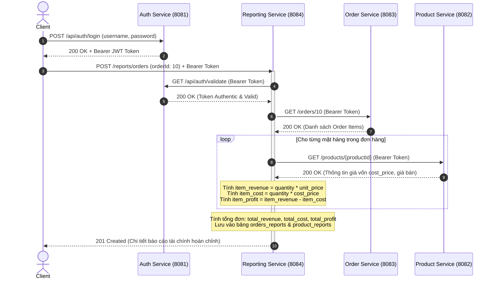

# Bài Thực Hành Số 5: Xây Dựng Dịch Vụ Báo Cáo (Reporting Service)
### Chuyên đề: Kiến Trúc Hướng Dịch Vụ (SOA - Service-Oriented Architecture) với Spring Boot & Java 21 LTS

---

## 1. Bối Cảnh & Kiến Trúc Tổng Thể Hệ Thống (SOA Architecture)

Trong hệ sinh thái thương mại điện tử phân tán theo kiến trúc **Service-Oriented Architecture (SOA)**, toàn bộ nghiệp vụ được chia thành các dịch vụ độc lập với cơ sở dữ liệu riêng biệt (*Database-per-Service*), giao tiếp với nhau thông qua giao thức chuẩn **RESTful HTTP (JSON)** và cơ chế xác thực tập trung **Bearer JWT Token**:

```
                                  ┌────────────────────────┐
                                  │      Client / UI       │
                                  │ (Swagger / cURL / App) │
                                  └───────────┬────────────┘
                                              │ 1. Đăng nhập lấy Bearer Token
                                              ▼
┌────────────────────────────────────────────────────────────────────────────────────────┐
│                                AUTH SERVICE (Port 8081)                                │
│                     - Cung cấp API /api/auth/login, /api/auth/validate                 │
└─────────────────────────────────────────────┬──────────────────────────────────────────┘
                                              │
                     ┌────────────────────────┴────────────────────────┐
                     │ 2. Gửi Request kèm Bearer Token                 │
                     ▼                                                 ▼
┌──────────────────────────────────────────┐     ┌─────────────────────────────────────────┐
│        ORDER SERVICE (Port 8083)         │     │       PRODUCT SERVICE (Port 8082)       │
│  - Quản lý đơn hàng (Orders)             │     │  - Quản lý sản phẩm (Products)          │
│  - Chi tiết mặt hàng (Order Items)       │     │  - Giá bán (unit_price) & Tồn kho       │
│  - Database riêng: `orders_db`           │     │  - Giá vốn nhập hàng (cost_price)       │
│                                          │     │  - Database riêng: `products_db`        │
└────────────────────┬─────────────────────┘     └────────────────────┬────────────────────┘
                     │                                                │
                     │ (GET /orders/{id})                             │ (GET /products/{id})
                     │ Lấy items, quantity, unit_price                │ Lấy cost_price, name
                     └────────────────────────┬───────────────────────┘
                                              │
                                              ▼
┌────────────────────────────────────────────────────────────────────────────────────────┐
│                        REPORTING SERVICE (Port 8084 - Trọng Tâm TH5)                   │
│  - Kiểm tra Bearer Token với Auth Service qua AuthFilter                               │
│  - RestClient (Spring 6.1+) tổng hợp dữ liệu từ Order Service & Product Service        │
│  - Tính toán tài chính: Doanh thu (Revenue), Chi phí (Cost), Lợi nhuận (Profit)         │
│  - Lưu trữ vào CSDL riêng biệt: H2 In-Memory / JPA (orders_reports, product_reports)   │
│  - OpenAPI 3 / Swagger UI: http://localhost:8084/swagger-ui.html                       │
└────────────────────────────────────────────────────────────────────────────────────────┘
```

### Sơ đồ tuần tự xử lý nghiệp vụ (Sequence Diagram):


---

## 2. Bảng Phân Tích Công Thức Nghiệp Vụ Tài Chính

Khi tạo báo cáo đơn hàng (`POST /reports/orders`) hoặc báo cáo sản phẩm (`POST /reports/products`), Reporting Service thực hiện tính toán tài chính với độ chính xác số học cao (`BigDecimal`, làm tròn 2 chữ số thập phân `HALF_UP`):

| Chỉ số tài chính | Ký hiệu / Thuộc tính DTO | Công thức toán học | Mô tả chi tiết |
| :--- | :--- | :--- | :--- |
| **Doanh thu mặt hàng** | `item_revenue` / `revenue` | $\text{quantity} \times \text{unit\_price}$ | Tổng tiền thu được từ số lượng bán nhân đơn giá bán. |
| **Giá vốn mặt hàng** | `item_cost` / `cost` | $\text{quantity} \times \text{cost\_price}$ | Chi phí gốc nhập hàng từ nhà cung cấp cho số lượng bán tương ứng. |
| **Lợi nhuận mặt hàng** | `item_profit` / `profit` | $\text{revenue} - \text{cost}$ | Khoản lợi nhuận gộp sinh ra từ mặt hàng đó trong đơn hàng. |
| **Tổng doanh thu đơn** | `total_revenue` | $\sum_{i=1}^{n} \text{item\_revenue}_i$ | Tổng doanh thu của tất cả $n$ mặt hàng trong đơn hàng. |
| **Tổng giá vốn đơn** | `total_cost` | $\sum_{i=1}^{n} \text{item\_cost}_i$ | Tổng chi phí nhập hàng của tất cả mặt hàng trong đơn hàng. |
| **Tổng lợi nhuận đơn** | `total_profit` | $\text{total\_revenue} - \text{total\_cost}$ | Lợi nhuận gộp cuối cùng mà doanh nghiệp thu về từ đơn hàng. |

### Ví dụ số liệu thực tế:
Đơn hàng gồm 2 sản phẩm:
- **Sản phẩm 1 (Laptop Dell XPS 15):** Bán 2 chiếc, giá bán $1,500.00, giá vốn $1,100.00.
  - $\text{Revenue} = 2 \times 1,500.00 = 3,000.00\text{ USD}$
  - $\text{Cost} = 2 \times 1,100.00 = 2,200.00\text{ USD}$
  - $\text{Profit} = 3,000.00 - 2,200.00 = 800.00\text{ USD}$
- **Sản phẩm 2 (Tai nghe chống ồn Sony):** Bán 3 chiếc, giá bán $400.00, giá vốn $250.00.
  - $\text{Revenue} = 3 \times 400.00 = 1,200.00\text{ USD}$
  - $\text{Cost} = 3 \times 250.00 = 750.00\text{ USD}$
  - $\text{Profit} = 1,200.00 - 750.00 = 450.00\text{ USD}$
- **Tổng kết đơn hàng:**
  - $\text{Total Revenue} = 3,000.00 + 1,200.00 = 4,200.00\text{ USD}$
  - $\text{Total Cost} = 2,200.00 + 750.00 = 2,950.00\text{ USD}$
  - $\text{Total Profit} = 4,200.00 - 2,950.00 = 1,250.00\text{ USD}$

---

## 3. Thiết Kế Cơ Sở Dữ Liệu Riêng (Database Schema)

Cơ sở dữ liệu độc lập của Reporting Service (H2 in-memory `jdbc:h2:mem:reportingdb` hoặc MySQL schema `reporting_db`):

```sql
CREATE TABLE orders_reports (
    id BIGINT AUTO_INCREMENT PRIMARY KEY,
    order_id BIGINT NOT NULL,
    total_revenue DECIMAL(10, 2) NOT NULL,
    total_cost DECIMAL(10, 2) NOT NULL,
    total_profit DECIMAL(10, 2) NOT NULL,
    created_at TIMESTAMP DEFAULT CURRENT_TIMESTAMP
);

CREATE TABLE product_reports (
    id BIGINT AUTO_INCREMENT PRIMARY KEY,
    order_report_id BIGINT,
    product_id BIGINT NOT NULL,
    total_sold INT NOT NULL,
    revenue DECIMAL(10, 2) NOT NULL,
    cost DECIMAL(10, 2) NOT NULL,
    profit DECIMAL(10, 2) NOT NULL,
    created_at TIMESTAMP DEFAULT CURRENT_TIMESTAMP,
    CONSTRAINT fk_order_report FOREIGN KEY (order_report_id) 
        REFERENCES orders_reports(id) ON DELETE CASCADE
);
```

---

## 4. Cấu Trúc Mã Nguồn (Project Structure)

```text
reporting-service/
├── pom.xml                                  # Cấu hình Spring Boot 3.3.4, Java 21, JPA, OpenAPI
├── src/main/java/com/example/reporting/
│   ├── ReportingServiceApplication.java     # Class main khởi chạy Reporting Service
│   ├── client/                              # Spring 6.1 RestClient gọi sang các SOA Service
│   │   ├── AuthServiceClient.java           # Xác thực Bearer Token qua Auth Service
│   │   ├── OrderServiceClient.java          # Lấy chi tiết đơn hàng từ Order Service
│   │   └── ProductServiceClient.java        # Lấy thông tin giá bán và giá vốn từ Product Service
│   ├── config/                              # Cấu hình hệ thống
│   │   ├── AuthFilter.java                  # Filter chặn & xác thực Bearer token (bảo mật SOA)
│   │   ├── OpenApiConfig.java               # Cấu hình Swagger UI 3 & SecurityScheme Bearer
│   │   └── RestClientConfig.java            # Cấu hình RestClient Timeout, RequestFactory
│   ├── controller/                          # REST Controllers chuẩn theo đề bài
│   │   ├── OrderReportController.java       # Endpoints /reports/orders/**
│   │   └── ProductReportController.java     # Endpoints /reports/products/**
│   ├── dto/                                 # Data Transfer Objects
│   │   ├── AuthValidationResponse.java
│   │   ├── ErrorResponse.java
│   │   ├── ExternalOrderDto.java
│   │   ├── ExternalOrderItemDto.java
│   │   ├── ExternalProductDto.java
│   │   ├── OrderReportRequest.java
│   │   ├── OrderReportResponse.java
│   │   ├── ProductReportRequest.java
│   │   └── ProductReportResponse.java
│   ├── entity/                              # JPA Entities
│   │   ├── OrderReport.java                 # Entity orders_reports (One-to-Many cascade)
│   │   └── ProductReport.java               # Entity product_reports
│   ├── exception/                           # Custom Exceptions & Xử lý lỗi toàn cục
│   │   ├── GlobalExceptionHandler.java      # @RestControllerAdvice trả về JSON chuẩn
│   │   ├── OrderNotFoundException.java      # 404 khi Order không tồn tại
│   │   ├── ProductNotFoundException.java    # 404 khi Product không tồn tại
│   │   ├── ResourceNotFoundException.java   # 404 khi Report ID không tồn tại
│   │   ├── ServiceUnavailableException.java # 503 khi service liên kết bị ngắt
│   │   └── UnauthorizedException.java       # 401 khi thiếu/sai Bearer Token
│   ├── repository/                          # Spring Data JPA Repositories
│   │   ├── OrderReportRepository.java
│   │   └── ProductReportRepository.java
│   └── service/                             # Nghiệp vụ tính toán Doanh thu, Chi phí, Lợi nhuận
│       ├── OrderReportService.java
│       ├── ProductReportService.java
│       └── impl/
│           ├── OrderReportServiceImpl.java
│           └── ProductReportServiceImpl.java
├── src/main/resources/
│   ├── application.yml                      # Cấu hình Port 8084, DB H2, Service URLs
│   └── schema.sql                           # Script DDL khởi tạo schema
├── src/test/java/                           # Bộ kiểm thử Unit Test JUnit 5 & Mockito
│   └── com/example/reporting/service/
│       ├── OrderReportServiceImplTest.java
│       └── ProductReportServiceImplTest.java
├── mock-support/                            # Dịch vụ phụ trợ giả lập để chạy SOA hoàn chỉnh
│   ├── pom.xml
│   └── src/main/
│       ├── java/com/example/mock/
│       │   ├── MockServicesApplication.java
│       │   ├── auth/MockAuthController.java       # Port 8081 (/api/auth/**)
│       │   ├── product/MockProductController.java # Port 8082 (/products/**)
│       │   └── order/MockOrderController.java     # Port 8083 (/orders/**)
│       └── resources/application.yml
├── run_all.bat                              # Script 1-click Windows (mở 4 cửa sổ CMD riêng)
├── run_all.sh                               # Script 1-click Linux/macOS (chạy nền + Health Check)
├── stop_all.sh                              # Script dừng tất cả các service đang chạy
├── test_reporting_api.sh                    # Script tự động cURL test toàn bộ luồng nghiệp vụ
└── README.md                                # Tài liệu hướng dẫn chi tiết
```

---

## 5. Danh Sách RESTful API Endpoints

Tất cả các API nghiệp vụ bắt buộc truyền header `Authorization: Bearer <TOKEN>`.

### 1. Báo cáo đơn hàng (`/reports/orders`):
| Method | Endpoint | Mô tả | Mã HTTP thành công |
| :--- | :--- | :--- | :--- |
| `POST` | `/reports/orders` | Tạo báo cáo tài chính cho đơn hàng dựa trên `orderId`. Tự động gọi Order Service và Product Service để tính toán và lưu cascade xuống `product_reports`. | `201 Created` |
| `GET` | `/reports/orders` | Lấy danh sách tất cả các báo cáo đơn hàng (kèm danh sách chi tiết các mặt hàng con). | `200 OK` |
| `GET` | `/reports/orders/{id}` | Lấy chi tiết báo cáo tài chính của một đơn hàng theo ID báo cáo. | `200 OK` |
| `DELETE` | `/reports/orders/{id}` | Xóa một báo cáo đơn hàng (cascade xóa các báo cáo sản phẩm con liên quan). | `204 No Content` |

### 2. Báo cáo sản phẩm (`/reports/products`):
| Method | Endpoint | Mô tả | Mã HTTP thành công |
| :--- | :--- | :--- | :--- |
| `POST` | `/reports/products` | Tạo báo cáo sản phẩm mới (dữ liệu giá bán, giá vốn có thể lấy tự động từ Product Service). | `201 Created` |
| `GET` | `/reports/products` | Lấy danh sách báo cáo sản phẩm (hỗ trợ query parameters: `?productId=...` hoặc `?orderReportId=...`). | `200 OK` |
| `GET` | `/reports/products/{id}` | Lấy chi tiết báo cáo của một sản phẩm theo ID báo cáo. | `200 OK` |
| `DELETE` | `/reports/products/{id}` | Xóa một báo cáo sản phẩm theo ID. | `204 No Content` |

---

## 6. Hướng Dẫn Cài Đặt Môi Trường & Khởi Chạy

### Yêu cầu hệ thống:
- **Java:** JDK 21 LTS (Oracle OpenJDK 21 hoặc Eclipse Temurin 21).
- **Maven:** Phiên bản 3.9+ (hoặc Maven Wrapper).
- **Hệ điều hành:** Windows 10/11, Ubuntu/Linux, macOS.

### Bước 1: Build mã nguồn
```bash
# Build Reporting Service chính
mvn clean package -DskipTests

# Build Mock Support Services (nếu chưa có sẵn các service TH2, TH3, TH4)
cd mock-support && mvn clean package -DskipTests && cd ..
```

### Bước 2: Khởi chạy toàn bộ hệ thống SOA (4 Services)

#### Trên Linux / macOS (1-Click Script):
```bash
chmod +x run_all.sh stop_all.sh test_reporting_api.sh
./run_all.sh
```
*Script sẽ tự động khởi chạy 4 tiến trình nền, thực hiện Health Check kiểm tra từng cổng HTTP cho đến khi sẵn sàng.*

#### Trên Windows (1-Click Batch Script):
Nhấp đúp chuột vào file **`run_all.bat`** (hoặc chạy trong PowerShell / Command Prompt):
```cmd
run_all.bat
```
*Script sẽ tự động mở 4 cửa sổ Command Prompt riêng biệt cho 4 microservices:*
- Cửa sổ 1: **Auth Service** (Port `8081`)
- Cửa sổ 2: **Product Service** (Port `8082`)
- Cửa sổ 3: **Order Service** (Port `8083`)
- Cửa sổ 4: **Reporting Service** (Port `8084`)

### Bước 3: Dừng toàn bộ hệ thống
```bash
./stop_all.sh
```

---

## 7. Hướng Dẫn Kiểm Thử Tự Động & cURL Kịch Bản Nghiệp Vụ

Hệ thống đã tích hợp sẵn script kiểm thử tự động toàn diện **`test_reporting_api.sh`**. 
Chỉ cần chạy:
```bash
./test_reporting_api.sh
```

### Kịch bản chi tiết thực hiện qua cURL:

#### Bước 1: Đăng nhập lấy Token từ Auth Service (Port 8081)
```bash
curl -X POST http://localhost:8081/api/auth/login \
  -H "Content-Type: application/json" \
  -d '{"username": "admin", "password": "password123"}'
```
*Response trả về chứa Bearer Token:*
```json
{
  "token": "eyJhbGciOiJIUzI1NiIsInR5cCI6IkpXVCJ9.mock-valid-token-admin.practice5",
  "tokenType": "Bearer",
  "username": "admin",
  "role": "ADMIN"
}
```

#### Bước 2: Tạo sản phẩm mới trong Product Service (Port 8082)
```bash
curl -X POST http://localhost:8082/products \
  -H "Content-Type: application/json" \
  -d '{
    "name": "Sony WH-1000XM5 Headphones",
    "unit_price": 400.00,
    "cost_price": 250.00,
    "stock_quantity": 40
  }'
```

#### Bước 3: Tạo đơn hàng mẫu trong Order Service (Port 8083)
```bash
curl -X POST http://localhost:8083/orders \
  -H "Content-Type: application/json" \
  -d '{
    "customer_id": "CUST_999",
    "customer_name": "Senior Architect Demo",
    "order_items": [
      {
        "product_id": 1,
        "quantity": 2,
        "unit_price": 1500.00
      },
      {
        "product_id": 11,
        "quantity": 3,
        "unit_price": 400.00
      }
    ]
  }'
```

#### Bước 4: Gọi POST /reports/orders để lập báo cáo tài chính
```bash
curl -X POST http://localhost:8084/reports/orders \
  -H "Content-Type: application/json" \
  -H "Authorization: Bearer <TOKEN>" \
  -d '{"orderId": 11}'
```
*Kết quả tính toán trả về:*
```json
{
  "id": 1,
  "orderId": 11,
  "totalRevenue": 4200.00,
  "totalCost": 2950.00,
  "totalProfit": 1250.00,
  "createdAt": "2026-11-09T11:38:45",
  "productReports": [
    {
      "id": 1,
      "orderReportId": 1,
      "productId": 1,
      "totalSold": 2,
      "revenue": 3000.00,
      "cost": 2200.00,
      "profit": 800.00
    },
    {
      "id": 2,
      "orderReportId": 1,
      "productId": 11,
      "totalSold": 3,
      "revenue": 1200.00,
      "cost": 750.00,
      "profit": 450.00
    }
  ]
}
```

#### Bước 5: Xem báo cáo và tài liệu Swagger UI
- **Xem chi tiết báo cáo:** `curl -H "Authorization: Bearer <TOKEN>" http://localhost:8084/reports/orders/1`
- **Giao diện OpenAPI Swagger UI:** Truy cập trình duyệt tại `http://localhost:8084/swagger-ui.html`
- **H2 Database Console:** Truy cập `http://localhost:8084/h2-console` (JDBC URL: `jdbc:h2:mem:reportingdb`, User: `sa`, Password để trống).

---

## 8. Kết Luận & Điểm Nổi Bật Về Mặt Kiến Trúc (Architecture Highlights)

1. **Tuân thủ triệt để nguyên lý SOA (Service-Oriented Architecture):**
   - Độc lập cơ sở dữ liệu (*Database-per-Service*), giảm tối đa sự phụ thuộc kết dính (*loose coupling*).
   - Phân tách ranh giới rõ ràng (*bounded context*): Quản lý người dùng & bảo mật (Auth), Danh mục sản phẩm & giá vốn (Product), Giao dịch mua hàng (Order), Phân tích nghiệp vụ & tài chính (Reporting).
2. **Công nghệ Spring Boot 3 & Java 21 hiện đại:**
   - Sử dụng **`RestClient`** (Spring 6.1+) với cấu hình Connection Timeout, Read Timeout và Fallback chống lỗi lan truyền (*Cascading Failure Prevention*).
   - Record & Virtual-thread friendly code base.
3. **Bảo mật phân tán với Bearer Token Filter:**
   - `AuthFilter` kết hợp cùng `AuthServiceClient` bảo vệ chặt chẽ các endpoint, trả về mã lỗi HTTP 401 chuẩn RESTful khi token không hợp lệ hoặc thiếu.
4. **Tự động hóa vận hành 100%:**
   - Hỗ trợ đầy đủ kịch bản khởi chạy đa nền tảng (`run_all.sh` cho Linux/macOS, `run_all.bat` cho Windows) và script test cURL tự động (`test_reporting_api.sh`).

